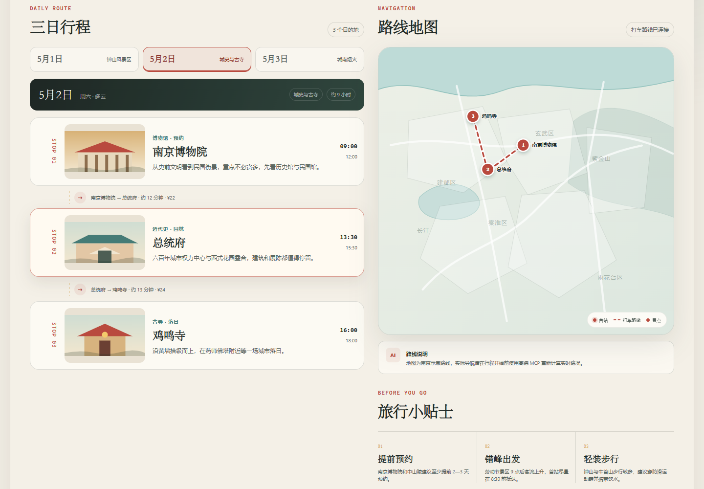

# 金陵三日 · 智能行程规划

面向华为 ICT 1.7 的南京劳动节三日旅行攻略。页面包含三天天气、每天三个景点、景点间打车信息、路线图和旅行贴士，支持桌面与手机浏览。



## 功能

- 2026 年 5 月 1 日至 3 日南京三日行程
- 3 张天气卡，点击可切换对应日期
- 每天恰好 3 个景点和 2 段打车路线
- 按日切换行程、日期摘要和地图路线
- 点击景点可高亮地图节点
- 本地 SVG 地图、景点插画和天气图标，无外部图片依赖
- 手机端单列布局，无横向溢出
- 无高德 Key 时使用离线演示数据，不产生费用

## 运行

```bash
python -m http.server 8130 --bind 127.0.0.1
```

浏览器打开 `http://127.0.0.1:8130`。

## 浏览器验证

```bash
python test-ui.py
```

测试使用 Playwright 与 Microsoft Edge，检查天气卡、三日标签、9 个景点、打车段、路线联动、移动端布局和外部请求。

## 高德 MCP 配置

1. 在高德开放平台创建 Web 服务 Key。
2. 将 `mcp_settings.example.json` 复制为码道的 `mcp_settings.json`。
3. 把示例中的占位文本替换为个人 Key。
4. 保存后重启码道 Agent 以刷新 MCP。
5. 不要把真实 Key 写入 `index.html`、`app.js` 或 Git。

配置格式：

```json
{
  "mcpServers": {
    "amap-maps-streamableHTTP": {
      "url": "https://mcp.amap.com/mcp?key=YOUR_KEY",
      "type": "streamableHttp"
    }
  }
}
```

## 项目结构

```text
travel-planner-mcp/
├─ index.html
├─ styles.css
├─ app.js
├─ test-ui.py
├─ mcp_settings.example.json
├─ .codeartsdoer/mcp/amap/.env.example
├─ screenshots/
└─ docs/
```
